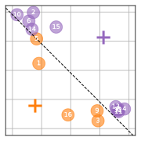
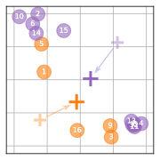
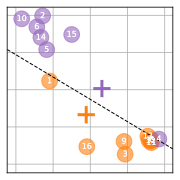
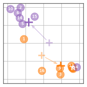
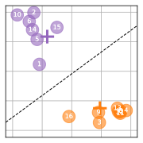
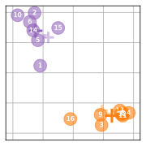

# Clustering

<!------------------------------------------------------------------------------------------------>

## Principle of clustering

Thresholding applies well on a grayscale image, for which it is easy to define a threshold from the modes of the histogram.
However, this approach cannot be applied on a color or multiband image because no histogram can be computed.

Each pixel in a $B$-band image can be represented by a point in a $B$-dimensional space.
By doing so, pixels with similar colors form groups in the space, as illustrated in @F:segmentation:clustering.

:::{figure} figs/3d-space.svg
:name: F:segmentation:clustering
:width: 600
Pixels of a $5 \times 5$ color image in a $B$-dimensional space ($B=3$).
:::

:::{margin}
In French, these methods are called *méthodes de classification*, although it would be more precise to call them *méthode de coalescence*.
:::

Clustering methods consists in defining groups of pixels.
Therefore, all the pixels in the same group define a class in the segmented image.

<!------------------------------------------------------------------------------------------------>

## The K-means algorithm

A classical clustering method for image segmentation is the K-means algorithm (French: *K-moyennes*) [[Steinhaus 1957](#B:segmentation:Steinhaus1957), [MacQueen 1967](#B:segmentation:MacQueen1967)].
This is an iterative method that affects every point in the space $\mathbb{R}^B$ to a group (called *cluster*).
The number $K$ of clusters is chosen by the user.

We also define *centroids* as the center of a cluster:
its coordinates are the mean of the point coordinates belonging to the cluster.

The K-means algorithm is given below.

:::{note} K-means algorithm
:icon: false

1. Initialize (randomly) the $K$ centroids
1. While the centroids vary:
   1. {span .badge}`STEP A` For each point:
      1. Calculate the distances from the point to all centroids
      1. Assign the point to the nearest cluster
   1. {span .badge}`STEP B` Calculate the centroid of each cluster
:::

:::{margin}
[A funny illustration of the K-means algorithm](https://allisonhorst.com/k-means-clustering).
:::

<!------------------------------------------------------------------------------------------------>

## Application on a toy example

The following illustrates the K-means algorithm on the 2D image shown @F:segmentation:kmeans-example.
The pixel intensities are drawn in a 2D space in @F:segmentation:kmeans-scatter.

:::{figure} figs/kmeans-intensities.svg
:height: 200
:name: F:segmentation:kmeans-example
A 4×4 image with two bands.
Suppose, for instance, that it is a remote sensing image showing a river flowing through a forest.
Left: the image with bands in green and blue.
Right: the image with the pixel intensities.
:::

:::{figure} figs/kmeans-scatter.svg
:height: 250
:name: F:segmentation:kmeans-scatter
A 4×4 image with two bands.
Suppose, for instance, that it is a remote sensing image showing a river flowing through a forest.
Left: the image with bands in green and blue.
Right: the image with the pixel intensities.
:::

We start with the following iteration:
:::{image} figs/step-0.svg
:align: center
:::

The 3 first iterations of the K-means algorithm are illustrated below.
The black dashed line represents the frontier between the centroids.

|  |  |
| :-: | :-: |
| **Iteration 1** &nbsp; {span .badge}`STEP A` Assign the pixels to the closest outlier  | **Iteration 2** &nbsp; {span .badge}`STEP B` Update the centroid location  |
| **Iteration 1** &nbsp; {span .badge}`STEP A` Assign the pixels to the closest outlier  | **Iteration 2** &nbsp; {span .badge}`STEP B` Update the centroid location  |
| **Iteration 1** &nbsp; {span .badge}`STEP A` Assign the pixels to the closest outlier  | **Iteration 2** &nbsp; {span .badge}`STEP B` Update the centroid location  |

<!------------------------------------------------------------------------------------------------>

## Application on a real image

@F:segmentation:kmeans-appli gives the result of the K-means algorithm on an image.

:::{figure} figs/kmeans-appli.svg
:width: 100%
:name: F:segmentation:kmeans-appli
Segmentation of a real remote sensing image with the K-means algorithm.
Left: observation, center: $K=2$ classes, right: $K=4$ classes.
Especially, the segmentation with $K=4$ classes identifies water, forest, artificial areas and meadows.
:::

<!------------------------------------------------------------------------------------------------>

## Discussion

The pros and cons of the K-means method for image segmentation are listed below.
In particular, the characteristics above identified with * are detailed hereafter.
Other clustering methods are available to avoid some of limits,
as for example Gaussian mixture modeling or mean-shift.

:::{card}
:header: 😀 Advantages of the K-means method
* simplicity
* easy to implement
* generally fast
* works correctly when the clusters are spherical*
:::

:::{card}
:header: ☹️ Disadvantages of the K-means method
* requires to know the number $K$ of classes
* sensitive to initialization
* can be slow in large dimensions
* fails for non-spherical structures*
* sensitive to outliers*
:::

### Spherical vs non-spherical clusters

Because the K-means algorithm performs the grouping with respect to the distance of the points to the centroids,
it assumes that the clusters are spherical.
Therefore, the algorithm works well for spherical clusters, but it fails if the clusters are not spherical,
as depicted in the images below.

:::{figure} figs/kmeans-ok.svg
:height: 200px
:name: F:segmentation:kmeans-ok
Spherical clusters: the K-means algorithm works well.
The points are depicted by $\bullet$ whose color correspond to the class,
and the centroids are depicted by a black $+$.
:::

:::{figure} figs/kmeans-croissants.svg
:height: 200px
:name: F:segmentation:kmeans-croissants
Non-spherical clusters: the K-means algorithm fails.
:::

### Sensitivity to outliers

In addition to this, the centroids are calculated as the mean of the points in the cluster.
But the mean is not a robust estimation and is sensitive to points located far from the cluster.
Thus, the algorithm may fail in the presence of outliers (*valeurs aberrantes*).

:::{figure} figs/kmeans-outliers.svg
:height: 200px
:name: F:segmentation:kmeans-outliers
Presence of outliers: the K-means algorithm fails in this example.
:::

   

<!-- ### Modèles paramétriques

L'histogramme de l'image est modélisé par un mélange de lois \eng{mixture model} :
on dispose d'un modèle paramétrique représentatif des classes présentes dans l'image.

  \includegraphics[width=10cm]{vincent52}

* Lois : souvent gaussiennes \eng{GMM : Gaussian mixture model}.
* Extension possible à plusieurs dimensions

Deux étapes :
\begin{enumerate}
* Estimation des paramètres des lois
  {\color{gray}Poids $\Pi_k$, moyennes $\mu_k$, écart-types $\sigma_k$}
    \includegraphics[width=6cm]{vincent54}
* Classification
  {\color{gray}Associer à chaque intensité la classe la plus représentative}
\end{enumerate}

\paragraph{{\color{unistra}$\blacksquare$\hspace*{-.6em}\scriptsize\sf\raisebox{.5mm}{\color{white}1}}\; Estimation}

$$
  \forall i,\qquad
  p(h(i)|\theta) = \sum_{k=1}^K \frac{\Pi_k}{\sqrt{2\pi\sigma_k^2}} \exp\left(-\frac{(h(i)-\mu_k)^2}{2\sigma_k^2}\right)
$$

où $K$ est le nombre de classes
et $\theta$ regroupe les paramètres inconnus des lois :
$\theta=[\Pi_1,...,\Pi_K,\mu_1,...,\mu_K,\sigma_1,...,\sigma_K]$.

Estimation des paramètres au sens du maximum de vraisemblance :

$$
  \hat{\theta}^\text{MV} = \arg \max_{\theta} \prod_i p(h(i)|\theta)
$$

Méthode de résolution : algorithme EM, algorithmes MCMC, ...

\paragraph{{\color{unistra}$\blacksquare$\hspace*{-.6em}\scriptsize\sf\raisebox{.5mm}{\color{white}2}}\; Classification}

  \includegraphics[width=6cm]{vincent54}

Chaque pixel est affecté à la classe dont il maximise la loi :

$$
  f_\text{seg}(m,n) = \arg \max_{k\in\{1,...,K\}}
    \frac{\Pi_k}{\sqrt{2\pi\sigma_k^2}} \exp\left(-\frac{(f(m,n)-\mu_k)^2}{2\sigma_k^2}\right)
$$

\paragraph{k-moyennes}
Estimation uniquement des $\mu_k$
Sensible à l'initialisation
Sensible aux minima locaux
Nécessite de connaître le nombre de classes
\includegraphics[width=4cm]{vincent58-kmeans}

\paragraph{Mélange de gaussiennes}
Estimation des $\mu_k$ et $\sigma_k$
Sensible à l'initialisation
Sensible aux minima locaux
Nécessite de connaître le nombre de classes
\includegraphics[width=4cm]{vincent58-gmm}
-->